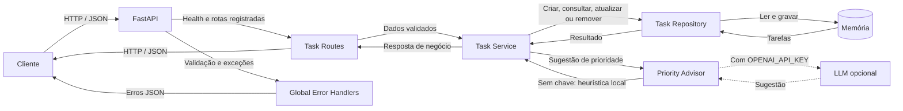

# Arquitetura

## Componentes

- **FastAPI:** instancia a aplicação, expõe `GET /health` e registra o router de tarefas.
- **Task Routes:** define os endpoints CRUD de tarefas e converte erros de recurso ausente em `404 Not Found`.
- **Global Error Handlers:** padroniza respostas JSON para erros de validação (`422`), HTTP (`404`) e falhas inesperadas (`500`).
- **Task Service:** concentra a orquestração entre persistência e sugestão de prioridade.
- **Task Repository:** armazena tarefas em memória durante a primeira release.
- **Priority Advisor:** usa heurística local sem custo e, opcionalmente, consulta uma LLM quando `OPENAI_API_KEY` estiver configurada.

## Limitações atuais

- O armazenamento em memória é reiniciado junto com o processo da aplicação.
- A integração com LLM é opcional e qualquer falha retorna a sugestão local, sem interromper o fluxo CRUD.
